<div align="center">

# 🔍 PRNU Camera Fingerprints
### Every photo carries an invisible fingerprint. Find the camera. Expose the fake.


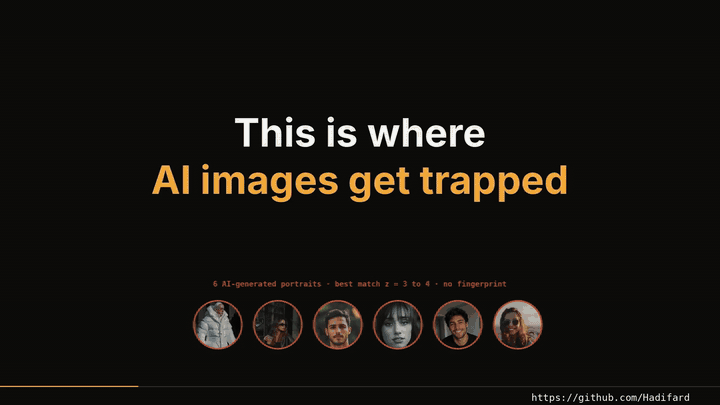

*A 2-minute teaser of the project video (GIF excerpt). Full videos are in the [Releases](https://github.com/Hadifard/PRNU_project_repo/releases).*

</div>

---

## ✨ In one minute

Every camera sensor has tiny, fixed manufacturing flaws: each pixel reacts to light a little differently. This pattern is called **PRNU** (Photo-Response Non-Uniformity). It is **unique, stable and invisible**, and it ends up in *every* photo the camera takes.

This project builds the whole chain in plain Python (NumPy, SciPy, OpenCV), from a 40-line detector to a modern PRNU pipeline, and tests it on **39 real, simulated and AI-generated images from 7 cameras**:

| What | Result |
|---|---|
| Which photos share a camera (Part 1, z > 10) | **19 of 30** photos with a known camera linked, **0 false matches** (highest wrong-camera z = 5.7) |
| AI-generated portraits (6) | no sensor, no fingerprint: z = 3.2 – 3.9, **never matched** |
| Edited photos traced to the right camera (Part 2, PCE) | **5 of 8** (crop, resize, rotate, splice and retouch survive; heavy edits do not) |
| Genuine photos above the PCE 60 decision level | **23 of 27** |
| Strongest wrong-camera PCE / wrong attributions | **32** (far below 60) / **0** |

> **Honest numbers.** The three Nikon bodies added in the final series are *mixed*: 8 of 14 photos are linked (one body 4/4, one 4/6, one 0/4). They add real evidence, but not a better average. Negative results are shown in the video and below.

---

## 🧠 The AI / machine-learning view

PRNU forensics is a compact example of the whole machine-learning loop: **a generative signal model → estimation → statistical decision → evaluation**. The code is written to make each step explicit.

| ML concept | In this project |
|---|---|
| **Generative model** | `I = I₀·(1 + K) + ε`: a photo is the scene times (1 + a fixed camera fingerprint K) plus noise |
| **Feature extraction** | the noise residual `W = I − F(I)`; `F` is a Gaussian blur (Part 1) or a wavelet + Wiener denoiser (Part 2) |
| **Estimation (maximum likelihood)** | `K̂ = Σ Wᵢ·Iᵢ / Σ Iᵢ²`: more photos, better estimate (the *learning curve* is Fig. 04 in the video) |
| **Similarity / decision rule** | normalised correlation → z-score, then **PCE** (peak-to-correlation energy) as a calibrated test statistic |
| **Hyper-parameter search** | rotation × resize factor × crop shift scanned with FFT cross-correlation |
| **Evaluation protocol** | leave-one-out *genuine vs impostor* comparisons, false-match counting, honest failure cases |
| **Explainability** | a local correlation map shows *where* a photo was edited |

### Where deep learning fits
The detector itself is classical and interpretable on purpose. Deep learning plugs in at three places (the video explains them, this repo is the baseline to compare against):

1. **CNN denoisers** (e.g. DnCNN) replace the wavelet filter `F` and give cleaner residuals.
2. **Noiseprint-style networks** (Cozzolino & Verdoliva) learn a *camera-model* fingerprint instead of a single-device one (bottom row of the figure below).
3. **Classifiers** `ŷ = softmax(f_θ(W))` predict the camera *model* from the residual.

<p align="center">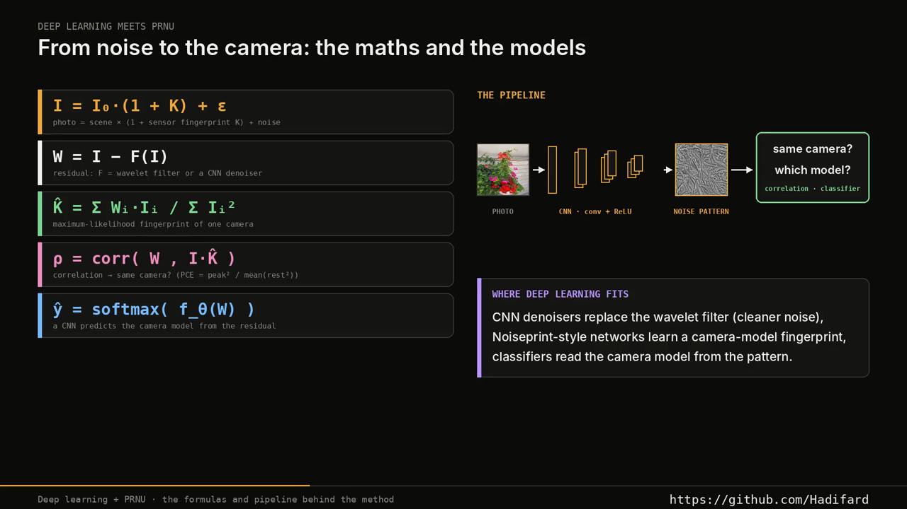 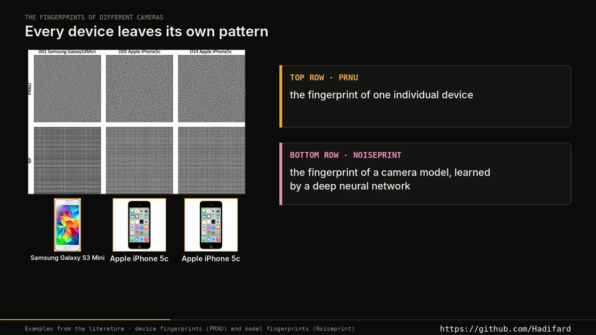</p>

> Roadmap ideas: train a small CNN residual extractor on the 7-camera set, add a camera-model classifier, and plot ROC curves from the genuine/impostor scores in `results/results_part2_7cameras.json`.

---

## 🧩 Pipeline

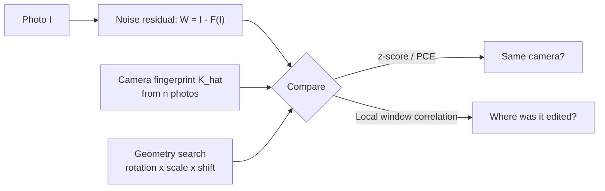

**Part 1 · `prnu_detect.py`** (the whole method in ~40 lines): residual = image − Gaussian blur, row/column pattern removed, edges muted; correlate every pair; `z = r·√N > 10` means *same camera*. Portrait photos are tried in both rotation directions.

**Part 2 · `prnu_v2.py`** (modern PRNU): undecimated wavelet denoiser with local-variance Wiener shrinkage, maximum-likelihood fingerprint, FFT cross-correlation over all shifts, **PCE > 60** decision level, rotation × scale search, sliding-window tamper map.

```python
import prnu_v2 as P
g   = P.load_gray("photo.jpg")                       # gray, sensor pixel frame
W   = P.extract_noise(g)                             # residual
K   = P.estimate_fingerprint(grays, noises)          # ML fingerprint from n photos
ref = P.Reference(K)
hit = P.search(g, ref, scales=[1.0, 0.8, 0.644], rots=(0, 1, 2, 3))
print(hit["pce"], hit["scale"], hit["rot"], hit["shift"])   # PCE > 60 -> same camera
```

---

## 📊 Results

### 1 · From a photo to its pixels
Zoom into a photo (Ava and Sophi): it is just a grid of numbers, `light × (1 + ε)`. The pixel flaw `ε` is the pattern we extract.

<p align="center">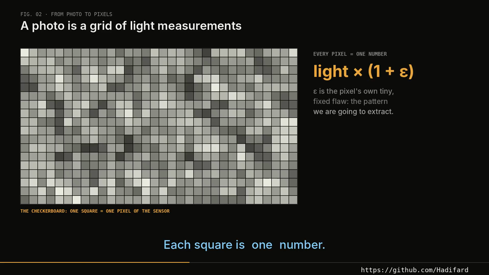</p>

### 2 · Same camera: a sharp spike. Different camera: chance.

<p align="center">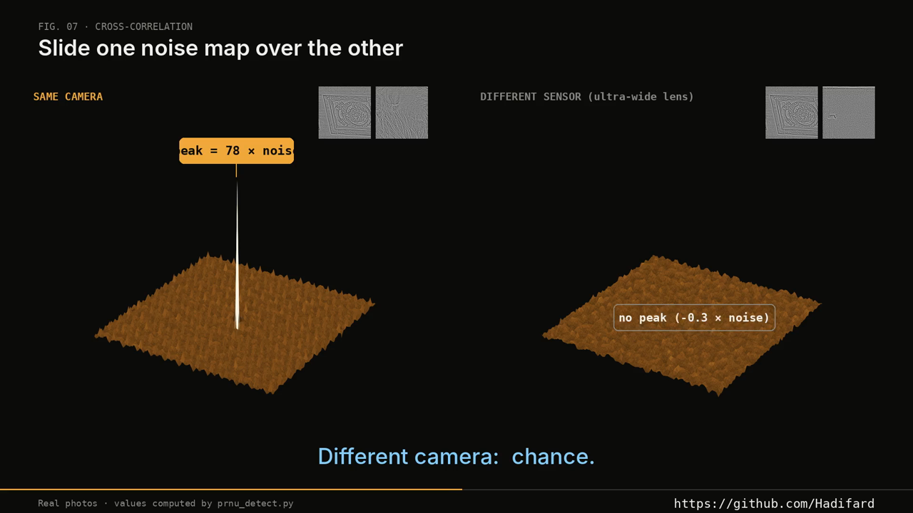</p>

### 3 · AI images: no sensor, no fingerprint
AI portraits reach only z = 3.2 – 3.9 (chance level). They are not matched to any camera. *No match is not proof of AI*: edited copies and weak sensors give no match either.

<p align="center">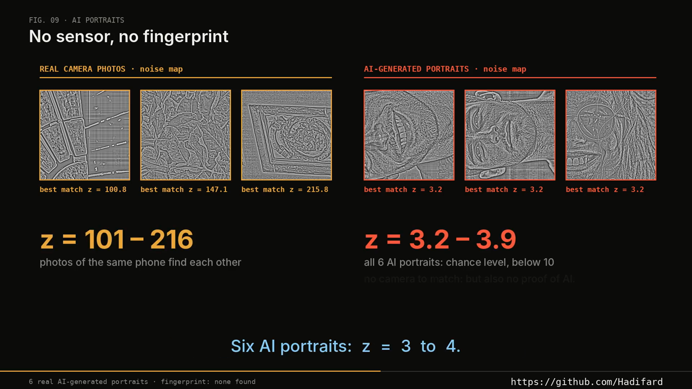 </p>

### 4 · Running the detector on 39 images
Every image is tagged automatically, the similarity matrix shows blocks of matching noise, and matches link into camera clusters.

<p align="center">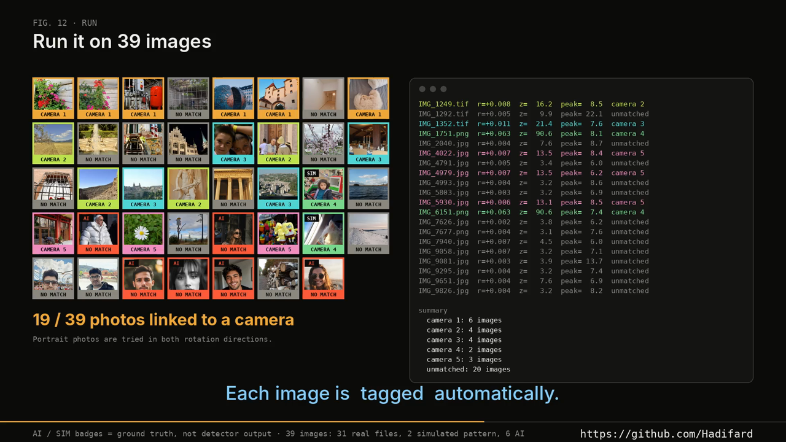 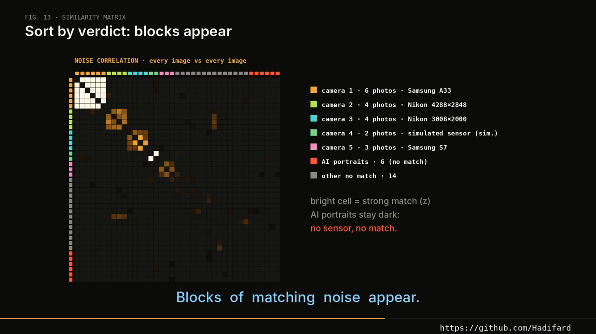</p>
<p align="center">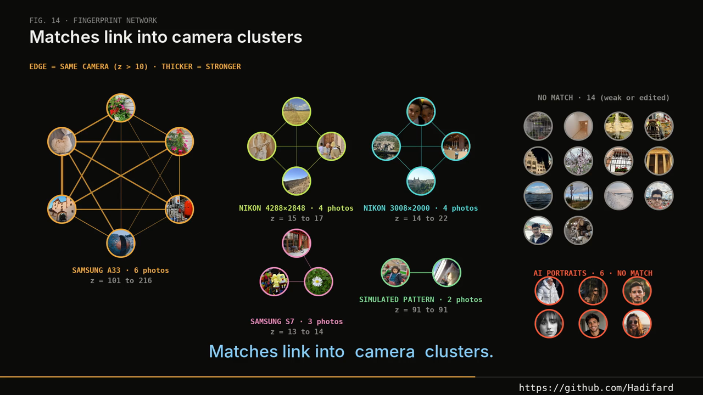</p>

| Camera | Photos linked | Best-match z |
|---|---|---|
| Samsung A33 (main lens) | 6 / 7 | 6 – 216 |
| Nikon 3008×2000 | **4 / 4** | 14 – 22 |
| Nikon 4288×2848 | 4 / 6 | 3 – 17 |
| Nikon 4928×3264 | 0 / 4 | 4.4 – 5.9 |
| Samsung S7 | 3 / 3 | 13 – 14 |
| Nokia 2.2 | 0 / 2 | 7.6 |
| Samsung A40 | 0 / 2 | 3.2 – 3.8 |
| Simulated sensor (2 resized photos, injected pattern) | 2 / 2 | 91 |
| AI portraits (6) | 0 / 6 false matches | 3.2 – 3.9 |

Raw output: [`results/run_output39.txt`](results/run_output39.txt), chart: [`results/result39.png`](results/result39.png).

### 5 · Part 2: seven real fingerprints
<p align="center">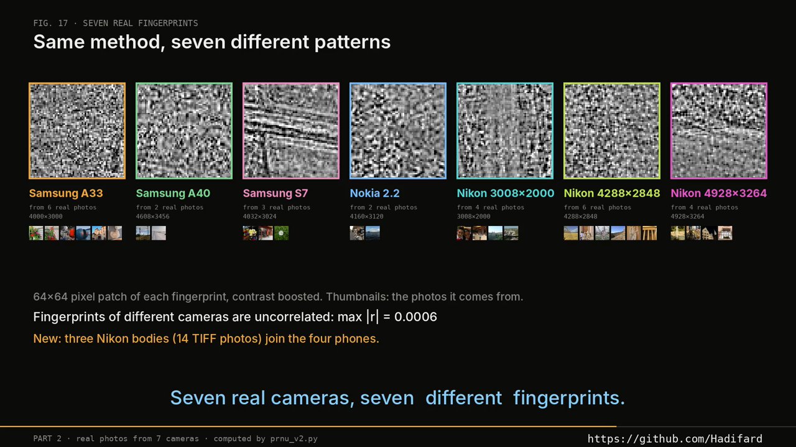</p>

### 6 · Edited photos: which camera took it?
<p align="center">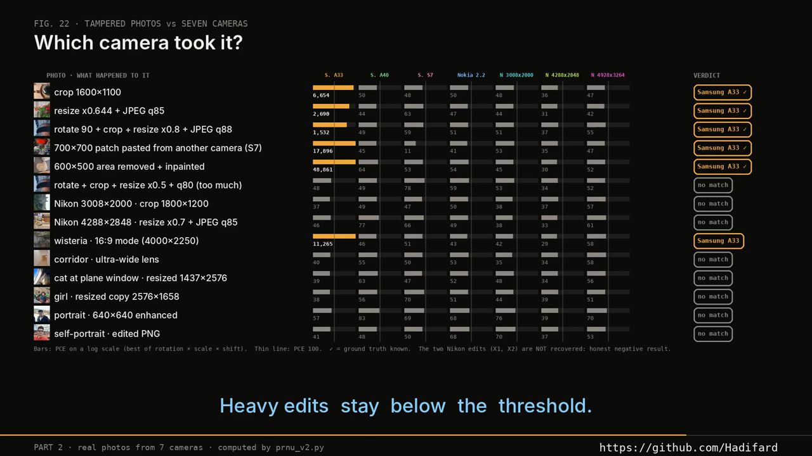</p>

Crop, resize, rotate + crop + resize, a pasted patch from another camera, and an inpainted object are all traced back to the Samsung A33. **Not recovered** (reported, not hidden): the heavy edit (resize ×0.5 + q80) and both Nikon edit tests (TIFF to JPEG q85-92 removes most of a weak fingerprint).

### 7 · Where was it edited?
<p align="center">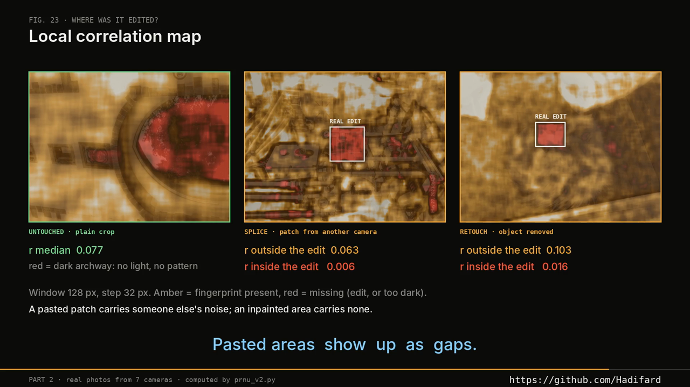</p>

A pasted patch carries someone else's noise, an inpainted area carries none: both show up as gaps in the local correlation map.

### 8 · Genuine vs impostor
<p align="center">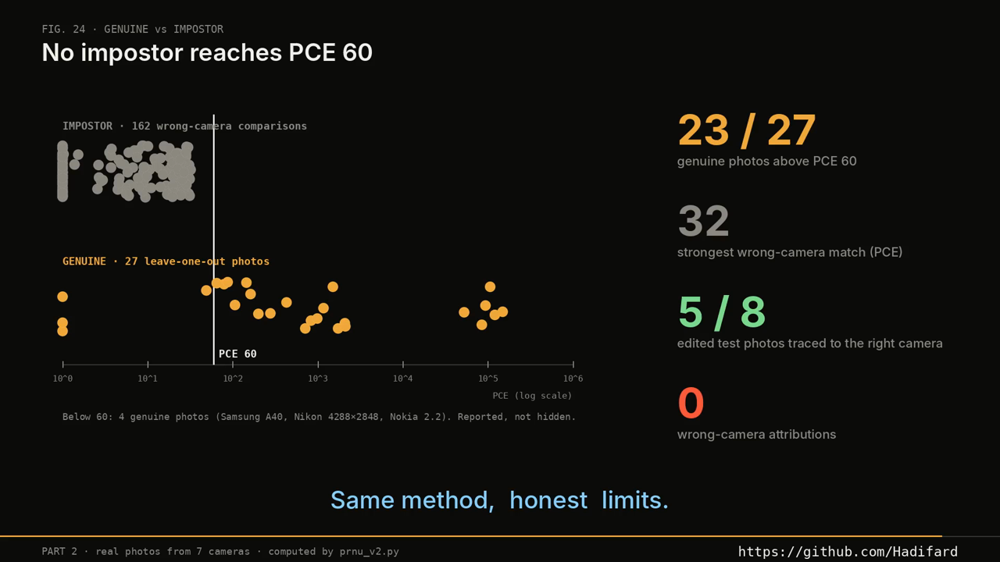</p>

Below PCE 60: both Samsung A40 photos (no usable fingerprint), one Nokia photo (49), and one Nikon 4288×2848 photo (0).

---

## ⚠️ Limits (honest)
- Resized, recompressed or edited copies weaken the fingerprint; heavy edits remove it.
- Some sensors are weak (Samsung A40, Nokia 2.2, one Nikon body) with only 2–6 reference photos.
- Camera 2 in the 39-image demo (girl, cat) uses a **simulated** pattern, because real patterns do not survive resizing. It is labelled `SIM` everywhere.
- The test set is small (39 images, 7 cameras): numbers show behaviour, not benchmark accuracy.
- A missing match never proves an image is AI-generated.

---

## 🚀 Quick start

```bash
git clone https://github.com/Hadifard/PRNU_project_repo.git
cd PRNU_project_repo
pip install -r requirements.txt            # ffmpeg must be on PATH for the videos

# your own images: which of them share a camera?
python prnu_detect.py --folder my_images/ --out result.png
```

Reproduce everything (downloads the data from the release, ~40 min on 2 CPU cores):

```bash
python run_all.py --no-video               # detector, assets, Part 2 (7 cameras)
python run_all.py                          # + both videos (needs the Inter font, see render_video.py)
```

## 🗂️ Repository

| File | Purpose |
|---|---|
| `prnu_detect.py` | Part 1 detector (blur residual, correlation, z-score, camera groups) |
| `prnu_v2.py` | Part 2 modern PRNU (wavelet residual, ML fingerprint, PCE, geometry search, tamper map) |
| `make_demo39.py` | builds the 39-image demo folder and `truth39.json` |
| `orient_nikon.py` | finds the rotation direction of portrait Nikon TIFFs |
| `prep_assets.py`, `prep_extra.py` | numbers and images of Part 1 |
| `prep_v2_orig.py`, `curves.py`, `prep_v2b.py` | Part 2 on 4 phones, scale curves, extension to 7 cameras |
| `render_video.py`, `render_teaser.py` | render the 350 s video and the 118 s teaser (Pillow + ffmpeg) |
| `download_data.py`, `run_all.py` | data download and the full pipeline |
| `results/` | detector output, ground truth, Part 2 numbers (JSON) |
| `docs/` | figures and the teaser GIF used in this README |

## 📚 References
- J. Lukáš, J. Fridrich, M. Goljan. *Digital Camera Identification from Sensor Pattern Noise.* IEEE TIFS, 2006.
- M. Goljan, J. Fridrich, T. Filler. *Large-Scale Test of Sensor Fingerprint Camera Identification.* SPIE, 2009 (PCE).
- M. Chen, J. Fridrich, M. Goljan, J. Lukáš. *Determining Image Origin and Integrity Using Sensor Noise.* IEEE TIFS, 2008.
- M. K. Mihcak, I. Kozintsev, K. Ramchandran. *Spatially adaptive statistical modeling of wavelet image coefficients.* ICASSP, 1999.
- D. Cozzolino, L. Verdoliva. *Noiseprint: a CNN-based camera model fingerprint.* IEEE TIFS, 2020.
- K. Zhang et al. *Beyond a Gaussian Denoiser (DnCNN).* IEEE TIP, 2017.

## 👤 Author
**Hadi Sarhangi Fard** · AI / Machine Learning / Deep Learning
[Portfolio](https://hadifard.github.io/) · [GitHub](https://github.com/Hadifard) · [LinkedIn](https://www.linkedin.com/in/hadi-sarhangi-fard-mech-eng) · [YouTube](https://www.youtube.com/@hfard)
