<div align="center">

# 🔍 PRNU Camera Fingerprints
### Every photo carries an invisible fingerprint. Find the camera. Expose the fake.


*A 2-minute teaser of the project video (GIF excerpt). Full videos are in the [Releases](https://github.com/Hadifard/PRNU_project_repo/releases).*

</div>

---

## ✨ In one minute

Every camera sensor has tiny, fixed manufacturing flaws: each pixel reacts to light a little differently. This pattern is called **PRNU** (Photo-Response Non-Uniformity). It is **unique, stable and invisible**, and it ends up in *every* photo the camera takes.

This project builds the whole chain in plain Python (NumPy, SciPy, OpenCV), from a 40-line detector to a modern PRNU pipeline, and tests it on **39 real, simulated and AI-generated images from 7 cameras**:

| What | Result |
|---|---|
| Which photos share a camera (Part 1, z > 10) | **19 of 30** photos with a known camera linked, **0 false matches** (highest wrong-camera z = 5.7) |
| AI-generated portraits (6) | no sensor, no fingerprint: z = 3.2 – 3.9, **never matched** |
| Edited photos traced to the right camera (Part 2, PCE) | **5 of 8** (crop, resize, rotate, splice and retouch survive; heavy edits do not) |
| Genuine photos above the PCE 60 decision level | **23 of 27** |
| Strongest wrong-camera PCE / wrong attributions | **32** (far below 60) / **0** |

> **Honest numbers.** The three Nikon bodies added in the final series are *mixed*: 8 of 14 photos are linked (one body 4/4, one 4/6, one 0/4). They add real evidence, but not a better average. Negative results are shown in the video and below.

---

## 🧠 The AI / machine-learning view

PRNU forensics is a compact example of the whole machine-learning loop: **a generative signal model → estimation → statistical decision → evaluation**. The code is written to make each step explicit.

| ML concept | In this project |
|---|---|
| **Generative model** | `I = I₀·(1 + K) + ε`: a photo is the scene times (1 + a fixed camera fingerprint K) plus noise |
| **Feature extraction** | the noise residual `W = I − F(I)`; `F` is a Gaussian blur (Part 1) or a wavelet + Wiener denoiser (Part 2) |
| **Estimation (maximum likelihood)** | `K̂ = Σ Wᵢ·Iᵢ / Σ Iᵢ²`: more photos, better estimate (the *learning curve* is Fig. 04 in the video) |
| **Similarity / decision rule** | normalised correlation → z-score, then **PCE** (peak-to-correlation energy) as a calibrated test statistic |
| **Hyper-parameter search** | rotation × resize factor × crop shift scanned with FFT cross-correlation |
| **Evaluation protocol** | leave-one-out *genuine vs impostor* comparisons, false-match counting, honest failure cases |
| **Explainability** | a local correlation map shows *where* a photo was edited |

### Where deep learning fits
The detector itself is classical and interpretable on purpose. Deep learning plugs in at three places (the video explains them, this repo is the baseline to compare against):

1. **CNN denoisers** (e.g. DnCNN) replace the wavelet filter `F` and give cleaner residuals.
2. **Noiseprint-style networks** (Cozzolino & Verdoliva) learn a *camera-model* fingerprint instead of a single-device one (bottom row of the figure below).
3. **Classifiers** `ŷ = softmax(f_θ(W))` predict the camera *model* from the residual.

<p align="center"> </p>

> Roadmap ideas: train a small CNN residual extractor on the 7-camera set, add a camera-model classifier, and plot ROC curves from the genuine/impostor scores in `results/results_part2_7cameras.json`.

---

## 🧩 Pipeline

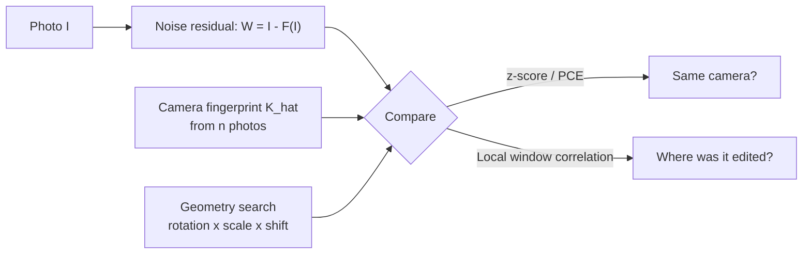

**Part 1 · `prnu_detect.py`** (the whole method in ~40 lines): residual = image − Gaussian blur, row/column pattern removed, edges muted; correlate every pair; `z = r·√N > 10` means *same camera*. Portrait photos are tried in both rotation directions.

**Part 2 · `prnu_v2.py`** (modern PRNU): undecimated wavelet denoiser with local-variance Wiener shrinkage, maximum-likelihood fingerprint, FFT cross-correlation over all shifts, **PCE > 60** decision level, rotation × scale search, sliding-window tamper map.

```python
import prnu_v2 as P
g   = P.load_gray("photo.jpg")                       # gray, sensor pixel frame
W   = P.extract_noise(g)                             # residual
K   = P.estimate_fingerprint(grays, noises)          # ML fingerprint from n photos
ref = P.Reference(K)
hit = P.search(g, ref, scales=[1.0, 0.8, 0.644], rots=(0, 1, 2, 3))
print(hit["pce"], hit["scale"], hit["rot"], hit["shift"])   # PCE > 60 -> same camera
```

---

## 📊 Results

### 1 · From a photo to its pixels
Zoom into a photo (Ava and Sophi): it is just a grid of numbers, `light × (1 + ε)`. The pixel flaw `ε` is the pattern we extract.

<p align="center"></p>

### 2 · Same camera: a sharp spike. Different camera: chance.

<p align="center"></p>

### 3 · AI images: no sensor, no fingerprint
AI portraits reach only z = 3.2 – 3.9 (chance level). They are not matched to any camera. *No match is not proof of AI*: edited copies and weak sensors give no match either.

<p align="center"> </p>

### 4 · Running the detector on 39 images
Every image is tagged automatically, the similarity matrix shows blocks of matching noise, and matches link into camera clusters.

<p align="center"> </p>
<p align="center"></p>

| Camera | Photos linked | Best-match z |
|---|---|---|
| Samsung A33 (main lens) | 6 / 7 | 6 – 216 |
| Nikon 3008×2000 | **4 / 4** | 14 – 22 |
| Nikon 4288×2848 | 4 / 6 | 3 – 17 |
| Nikon 4928×3264 | 0 / 4 | 4.4 – 5.9 |
| Samsung S7 | 3 / 3 | 13 – 14 |
| Nokia 2.2 | 0 / 2 | 7.6 |
| Samsung A40 | 0 / 2 | 3.2 – 3.8 |
| Simulated sensor (2 resized photos, injected pattern) | 2 / 2 | 91 |
| AI portraits (6) | 0 / 6 false matches | 3.2 – 3.9 |

Raw output: [`results/run_output39.txt`](results/run_output39.txt), chart: [`results/result39.png`](results/result39.png).

### 5 · Part 2: seven real fingerprints
<p align="center"></p>

### 6 · Edited photos: which camera took it?
<p align="center"></p>

Crop, resize, rotate + crop + resize, a pasted patch from another camera, and an inpainted object are all traced back to the Samsung A33. **Not recovered** (reported, not hidden): the heavy edit (resize ×0.5 + q80) and both Nikon edit tests (TIFF to JPEG q85-92 removes most of a weak fingerprint).

### 7 · Where was it edited?
<p align="center"></p>

A pasted patch carries someone else's noise, an inpainted area carries none: both show up as gaps in the local correlation map.

### 8 · Genuine vs impostor
<p align="center"></p>

Below PCE 60: both Samsung A40 photos (no usable fingerprint), one Nokia photo (49), and one Nikon 4288×2848 photo (0).

---

## 📈 Complete figures and tables (first full run: 20 images, 4 cameras)

This section collects **every chart and table** of the first complete run, with a short explanation of what each one shows. The run used **20 images**: 10 untouched real photos (6 from the Samsung A33), 5 images with an injected *simulated* sensor pattern, and 5 procedural *AI-style* images (marked simulated). Part 2 uses the **4 real phones** (Samsung A33, A40, S7, Nokia 2.2). The numbers therefore differ from the 39-image / 7-camera run above; both are reported as they were computed. The raw values behind each figure are in `results/*.csv`.

> **How to read the statistics.** `r` is the normalised correlation of two noise maps. `z = r·√N` counts how many standard deviations above chance it is (**z > 10 = same camera**). **PCE** (peak-to-correlation energy) is the stricter Part 2 statistic (**PCE > 60** decision level; the tamper table uses the stricter 100).

### Part 1 · The detector

#### Overview of the run
<p align="center">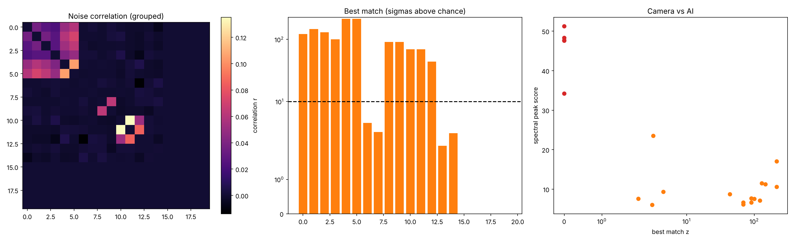</p>

Three views of the same run: the sorted similarity matrix (left), the best-match z per image (centre, dashed line = z 10), and camera photos vs AI-style images (right).

#### Averaging photos grows the fingerprint
<p align="center">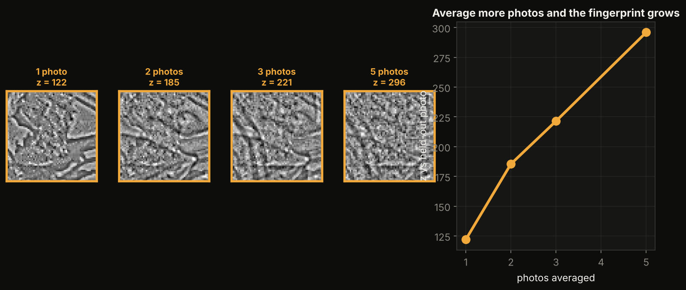</p>

The fingerprint estimate improves with every photo that is averaged: measured against a held-out photo, `z` rises from 122 (1 photo) to 296 (5 photos).

| photos averaged | r vs held-out photo | z |
|---|---|---|
| 1 | 0.0595 | 121.9 |
| 2 | 0.0905 | 185.4 |
| 3 | 0.1081 | 221.4 |
| 5 | 0.1445 | 296.0 |

#### Unique, stable, invisible
<p align="center">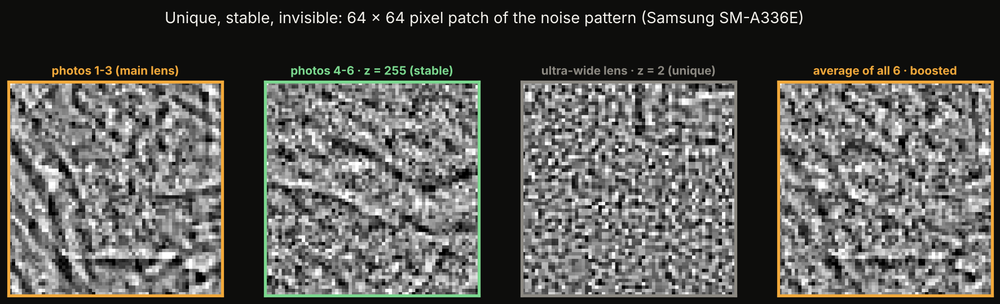</p>

A 64 × 64 patch of the Samsung A33 noise pattern. Photos 1-3 and photos 4-6 of the main lens give the **same** pattern (z = 255: *stable*), the ultra-wide lens gives a different one (z = 2: *unique*), and none of it is visible in a normal photo. The fourth tile is the average of all six photos, contrast boosted.

#### Extracting the noise: photo − blur = noise
<p align="center">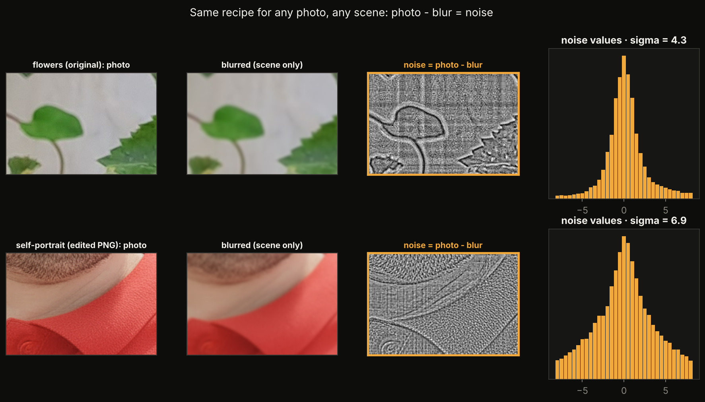</p>

Same recipe for any photo and any scene: blur the photo (scene only), subtract it, and only the noise remains. Left: an original phone photo (flowers); below: an edited PNG self-portrait. The histograms show the noise values (σ = 4.3 and 6.9 gray levels).

| photo | size (px) | noise sigma in patch (gray levels) |
|---|---|---|
| flowers (original) | 3000 x 4000 | 4.30 |
| self-portrait (edited PNG) | 864 x 1184 | 6.93 |
| girl (resized copy) | 2576 x 1658 | 10.59 |

#### Correlation: each dot is one pixel
<p align="center">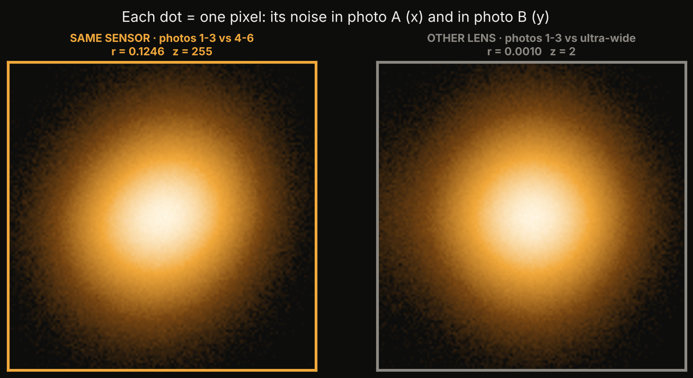</p>

Every dot compares one pixel's noise in photo A (x) with photo B (y). **Same sensor** (photos 1-3 vs 4-6): a clear diagonal cloud, r = 0.1246, z = 255. **Other lens** (main vs ultra-wide): a round cloud with no relation, r = 0.0010, z = 2.

#### Cross-correlation: a sharp spike
<p align="center">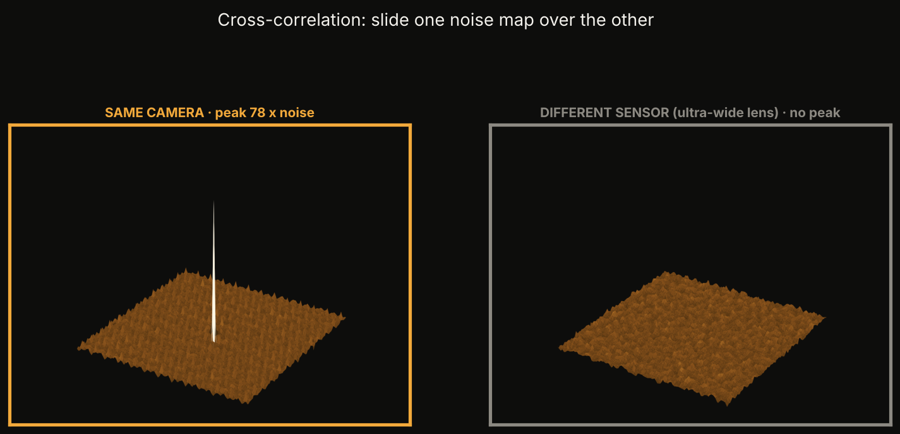</p>

Sliding one noise map over the other: the **same camera** produces one sharp peak (78 × the noise floor); a **different sensor** (ultra-wide lens) produces only a flat noise floor.

#### Two clouds, one wide gap
<p align="center">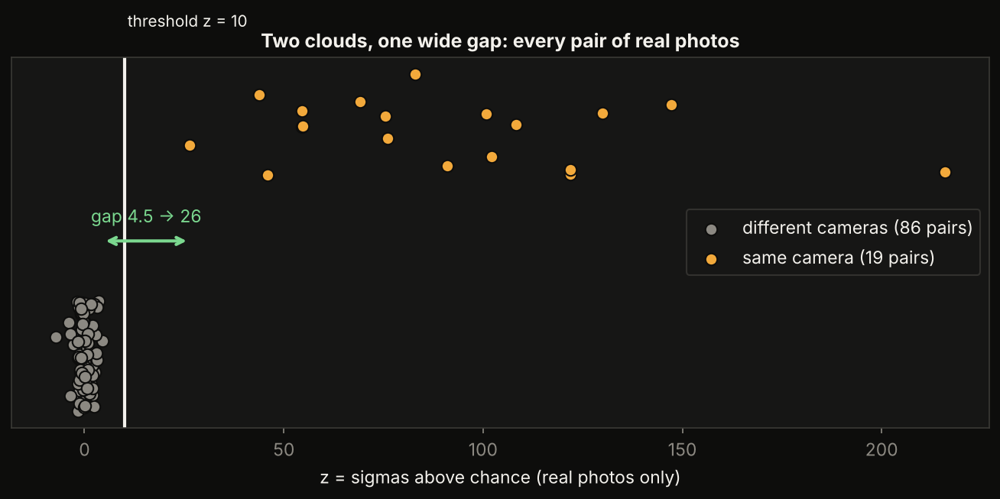</p>

Every pair of real photos: pairs from **different cameras** (86 pairs, grey, maximum z = 4.5) cluster at zero; pairs from the **same camera** (19 pairs, orange, z = 26 to 216) lie far to the right. The threshold z = 10 separates them with a gap from 4.5 to 26.

#### Best match per image
<p align="center">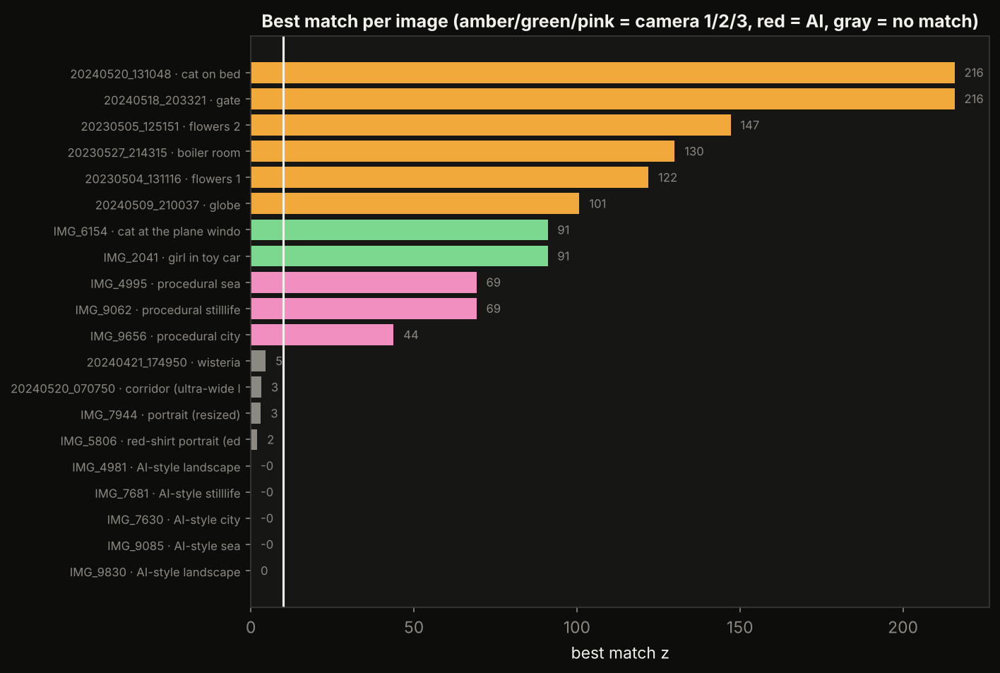</p>

Best-match z of every image (amber / green / pink = camera 1 / 2 / 3, red = AI-style, grey = no match). Real Samsung A33 photos reach z up to 216, the AI-style images score 0.

#### Similarity matrix
<p align="center">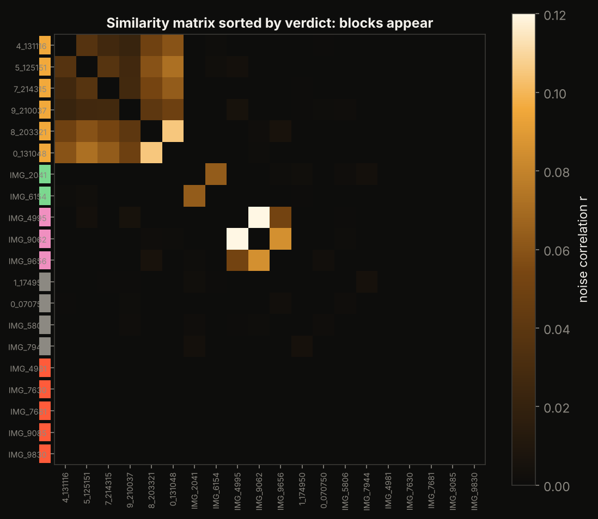</p>

All images against all images, sorted by verdict: **blocks** of bright cells appear where photos share a camera (the large amber block is the Samsung A33). AI-style images (red) are dark: they correlate with nothing.

#### Spectral peak: the AI-style check
<p align="center">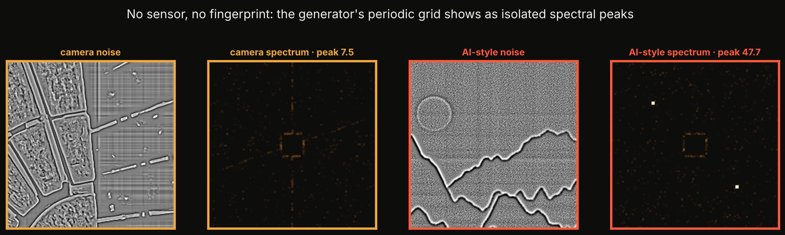</p>

Camera noise vs the noise of an AI-style image, and the Fourier spectrum of each. The simulated generator leaves a **periodic grid** that shows up as isolated spectral peaks (peak score 47.7, camera 7.5).

<p align="center">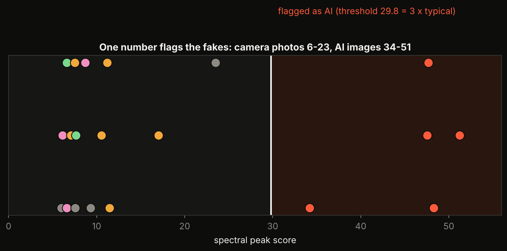</p>

One number flags the simulated AI-style images: camera photos score 6.0 - 23.5, AI-style images 34.2 - 51.2, threshold 29.8 (3 × the typical score). **Caveat:** this works on the *simulated* generator pattern of this demo; the six real AI portraits in the main video are *not* flagged by it.

<p align="center">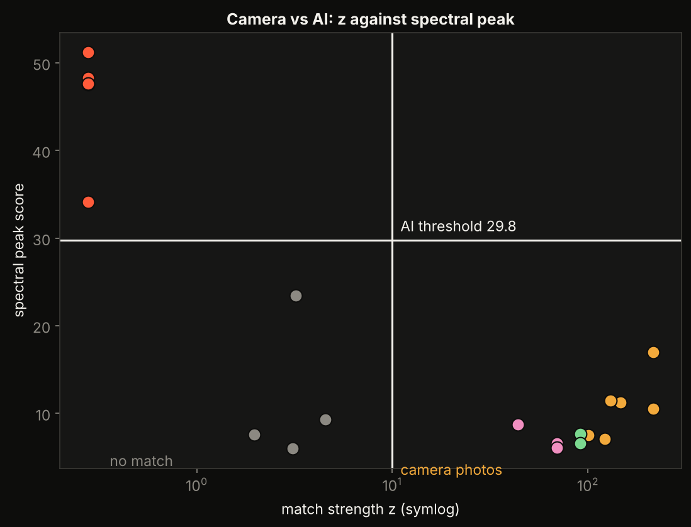</p>

Camera vs AI-style: match strength z (x) against spectral peak score (y). Camera photos sit bottom right (high z, low peak), AI-style images top left (z = 0, high peak).

#### Part 1 tables

Summary of the run:

| quantity | value |
|---|---|
| images analysed | 20 |
| camera 1 (real Samsung A33) found | 6 of 6 main-camera originals |
| camera 2 / camera 3 (simulated sensors) | 2 / 3 images |
| AI-style images flagged | 5 of 5 |
| false camera matches among real pairs | 0 of 86 different-camera pairs above z = 10 |
| same-camera pairs (real) | 19 pairs, z from 26.4 to 215.8 |
| different-camera pairs (real) | 86 pairs, max z = 4.5 |
| strongest match | z = 216 (r = 0.135) |
| AI spectral peak scores | 34.2 to 51.2 |
| camera spectral peak scores | 6.0 to 23.5 |
| AI threshold (3 x median) | 29.8 |
| fingerprint 3 photos vs 3 photos (same lens) | r = 0.1246, z = 255 |
| fingerprint main lens vs ultra-wide lens | r = 0.0010, z = 2.0 |
| cross-correlation peak, same camera | 78.5 x noise floor |
| cross-correlation peak, other lens | -0.26 x noise floor |

<details>
<summary>Full per-image results (20 images)</summary>

| file | content | origin | ground truth | r (best match) | z (best match) | spectral peak | verdict |
|---|---|---|---|---|---|---|---|
| 20230504_131116.jpg | flowers 1 | real photo | Samsung A33 (real) | +0.060 | 121.9 | 7.1 | camera 1 |
| 20230505_125151.jpg | flowers 2 | real photo | Samsung A33 (real) | +0.072 | 147.1 | 11.2 | camera 1 |
| 20230527_214315.jpg | boiler room | real photo | Samsung A33 (real) | +0.063 | 130.0 | 11.5 | camera 1 |
| 20240421_174950.jpg | wisteria | real photo | no usable fingerprint | +0.003 | 4.5 | 9.3 | unmatched |
| 20240509_210037.jpg | globe | real photo | Samsung A33 (real) | +0.049 | 100.8 | 7.5 | camera 1 |
| 20240518_203321.jpg | gate | real photo | Samsung A33 (real) | +0.105 | 215.8 | 17.0 | camera 1 |
| 20240520_070750.jpg | corridor (ultra-wide lens) | real photo | no usable fingerprint | +0.002 | 3.2 | 23.5 | unmatched |
| 20240520_131048.jpg | cat on bed | real photo | Samsung A33 (real) | +0.105 | 215.8 | 10.6 | camera 1 |
| IMG_2041.png | girl in toy car | real/procedural + simulated pattern | simulated sensor A | +0.063 | 91.0 | 7.6 | camera 2 |
| IMG_4981.png | AI-style landscape | procedural AI-style | AI-style (simulated) | -0.000 | -0.0 | 34.2 | AI-generated |
| IMG_4995.png | procedural sea | real/procedural + simulated pattern | simulated sensor B | +0.135 | 69.2 | 6.6 | camera 3 |
| IMG_5806.png | red-shirt portrait (edited PNG) | real photo | no usable fingerprint | +0.002 | 2.0 | 7.6 | unmatched |
| IMG_6154.png | cat at the plane window | real/procedural + simulated pattern | simulated sensor A | +0.063 | 91.0 | 6.6 | camera 2 |
| IMG_7630.png | AI-style city | procedural AI-style | AI-style (simulated) | -0.000 | -0.0 | 48.3 | AI-generated |
| IMG_7681.png | AI-style stilllife | procedural AI-style | AI-style (simulated) | -0.000 | -0.0 | 47.6 | AI-generated |
| IMG_7944.jpg | portrait (resized) | real photo | no usable fingerprint | +0.005 | 3.1 | 6.0 | unmatched |
| IMG_9062.png | procedural stilllife | real/procedural + simulated pattern | simulated sensor B | +0.135 | 69.2 | 6.1 | camera 3 |
| IMG_9085.png | AI-style sea | procedural AI-style | AI-style (simulated) | -0.000 | -0.0 | 51.2 | AI-generated |
| IMG_9656.png | procedural city | real/procedural + simulated pattern | simulated sensor B | +0.086 | 43.8 | 8.7 | camera 3 |
| IMG_9830.png | AI-style landscape | procedural AI-style | AI-style (simulated) | -0.000 | -0.0 | 47.7 | AI-generated |

</details>


### Part 2 · Modern PRNU on four real phones

#### Four real fingerprints
<p align="center">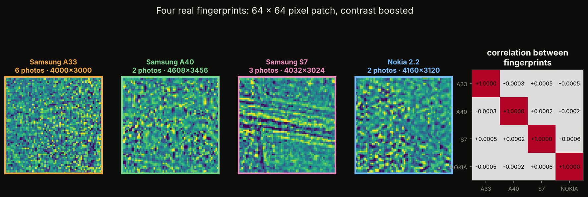</p>

64 × 64 patch of each phone's fingerprint (contrast boosted). They look different and are indeed uncorrelated: the matrix on the right shows correlations of about ±0.0005 between different phones and 1.0 on the diagonal.

| id | camera | photos used for the fingerprint | sensor frame (px) |
|---|---|---|---|
| A33 | Samsung A33 | 6 | 4000 x 3000 |
| A40 | Samsung A40 | 2 | 4608 x 3456 |
| S7 | Samsung S7 | 3 | 4032 x 3024 |
| NOKIA | Nokia 2.2 | 2 | 4160 x 3120 |

Correlation between the fingerprints:

|  | Samsung A33 | Samsung A40 | Samsung S7 | Nokia 2.2 |
|---|---|---|---|---|
| Samsung A33 | +1.0000 | -0.0003 | +0.0005 | -0.0005 |
| Samsung A40 | -0.0003 | +1.0000 | +0.0002 | -0.0002 |
| Samsung S7 | +0.0005 | +0.0002 | +1.0000 | +0.0006 |
| Nokia 2.2 | -0.0005 | -0.0002 | +0.0006 | +1.0000 |

#### Fingerprint pixel values
<p align="center">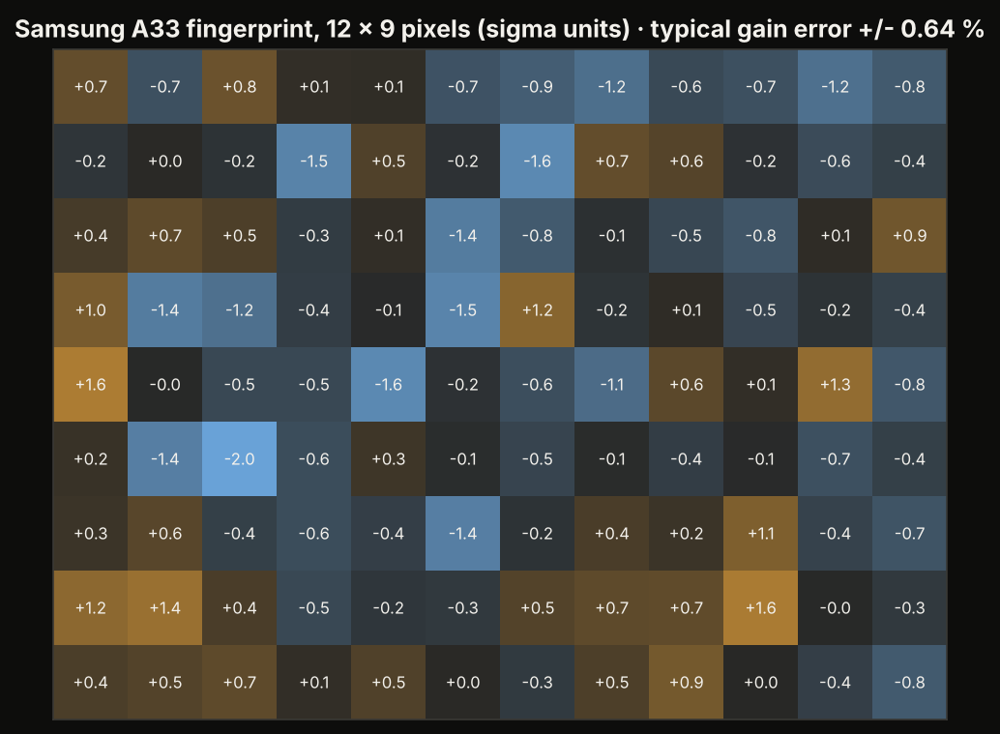</p>

The Samsung A33 fingerprint as numbers (12 × 9 pixels, in sigma units): each pixel has a tiny, fixed gain error, typically **±0.64 %**.

#### A better noise estimate
<p align="center">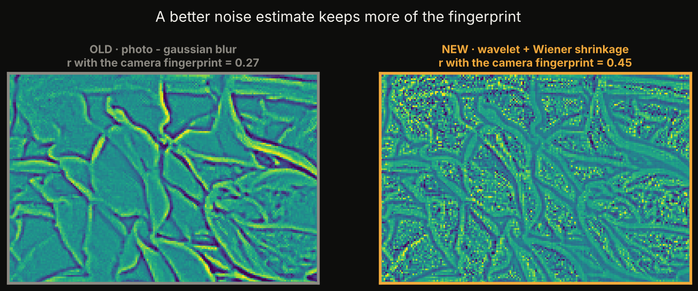</p>

The old Gaussian-blur residual (left) correlates with the camera fingerprint at r = 0.27; the new **wavelet + Wiener** residual (right) keeps more of the fingerprint: r = 0.45.

#### Where on the sensor was it taken?
<p align="center">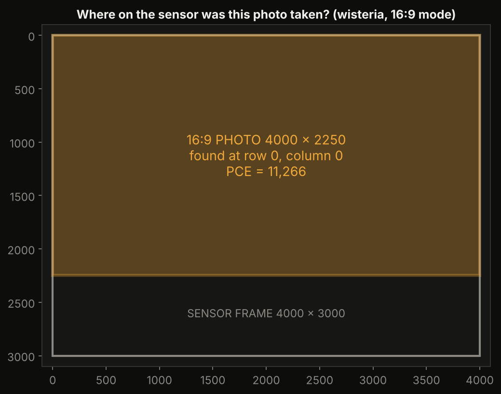</p>

FFT cross-correlation over **all shifts** locates a crop on the sensor frame. The 16:9 wisteria photo (4000 × 2250) is found at row 0, column 0 of the 4000 × 3000 frame with PCE = 11,266.

#### Scanning the resize factor
<p align="center">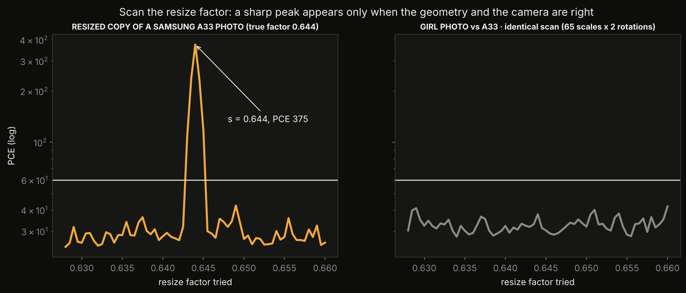</p>

For a resized copy of an A33 photo, a sharp peak appears **only at the true factor** (0.644, PCE 375). The identical scan of a photo from another camera (right) stays flat.

#### The PCE surface
<p align="center">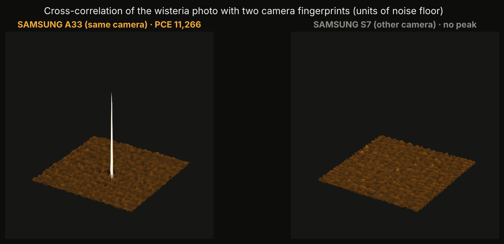</p>

Cross-correlation of the wisteria photo with two fingerprints, in units of the noise floor: the **same camera** (Samsung A33) gives a spike with PCE = 11,266; the **other camera** (Samsung S7) shows no peak.

#### The controlled tamper set
<p align="center">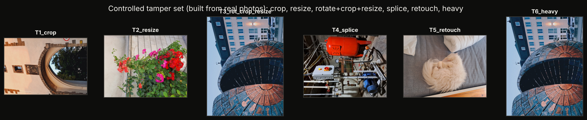</p>

Six edits built from real A33 photos: **T1** crop, **T2** resize, **T3** rotate + crop + resize, **T4** splice (a patch from another camera), **T5** retouch (object removed and inpainted), **T6** heavy (rotate + crop + resize × 0.5 + JPEG q80).

#### Which camera took the edited photo?
<p align="center">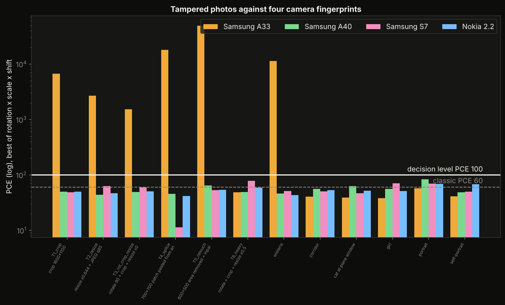</p>

PCE of each edited / unknown photo against the four fingerprints (log scale; solid line = decision level 100, dashed = classic 60). Crop, resize, rotate + crop + resize, splice and retouch are all traced to the **Samsung A33**, the wisteria photo too (PCE 11,266). Wrong cameras stay near PCE 50. **Not recovered** (reported, not hidden): the heavy T6 edit.

<details>
<summary>Attribution table (PCE, best scale, rotation and shift)</summary>

| photo | what happened to it | true camera | PCE vs Samsung A33 | PCE vs Samsung A40 | PCE vs Samsung S7 | PCE vs Nokia 2.2 | verdict (PCE > 100) | best scale | best rotation (deg) | shift (row, col) |
|---|---|---|---|---|---|---|---|---|---|---|
| T1_crop.jpg | crop 1600x1100 | A33 | 6,654 | 49.9 | 48.3 | 49.8 | Samsung A33 | 1.000 | 0 | (900, 1500) |
| T2_resize.jpg | resize x0.644 + JPEG q85 | A33 | 2,691 | 44.0 | 62.4 | 46.6 | Samsung A33 | 0.644 | 0 | (0, 0) |
| T3_rot_crop_resize.jpg | rotate 90 + crop + resize x0.8 + JPEG q88 | A33 | 1,530 | 49.1 | 59.2 | 50.6 | Samsung A33 | 0.800 | 270 | (400, 1300) |
| T4_splice.jpg | 700x700 patch pasted from another camera (S7) | A33 | 17,900 | 45.5 | 11.3 | 41.5 | Samsung A33 | 1.000 | 0 | (0, 0) |
| T5_retouch.jpg | 600x500 area removed + inpainted | A33 | 48,862 | 64.5 | 53.2 | 54.1 | Samsung A33 | 1.000 | 0 | (0, 0) |
| T6_heavy.jpg | rotate + crop + resize x0.5 + q80 (too much) | A33 | 48.4 | 49.3 | 78.4 | 58.7 | no match | 1.000 | 0 | (1321, 156) |
| 20240421_174950.jpg | wisteria · 16:9 mode (4000x2250) | unknown | 11,266 | 45.8 | 50.9 | 43.1 | Samsung A33 | 1.000 | 0 | (0, 0) |
| 20240520_070750.jpg | corridor · ultra-wide lens | unknown | 40.3 | 55.6 | 50.1 | 52.9 | no match | 0.500 | 0 | (283, -1682) |
| cat_plane.jpg | cat at plane window · resized 1437x2576 | unknown | 38.9 | 63.0 | 46.7 | 52.0 | no match | 0.800 | 180 | (1088, 2987) |
| girl.jpg | girl · resized copy 2576x1658 | unknown | 38.2 | 55.8 | 70.0 | 50.9 | no match | 0.500 | 270 | (-1343, 1128) |
| man.jpg | portrait · 640x640 enhanced | unknown | 57.4 | 83.5 | 69.2 | 68.4 | no match | 1.000 | 180 | (1949, 3685) |
| red_shirt.png | self-portrait · edited PNG | unknown | 41.0 | 48.4 | 49.6 | 67.6 | no match | 1.000 | 0 | (1907, 1984) |

</details>


#### Tamper maps
<p align="center">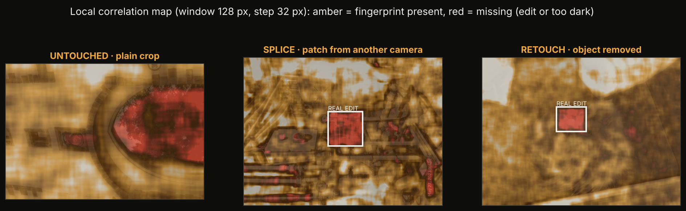</p>

Local correlation map (window 128 px, step 32 px): **amber** = fingerprint present, **red** = missing. An untouched crop is amber throughout; the **spliced** patch (another camera's noise) and the **retouched** object (no noise) show up as red gaps.

| test photo | mean r outside the edit | mean r inside the edit |
|---|---|---|
| T4_splice.jpg | 0.063 | 0.006 |
| T5_retouch.jpg | 0.103 | 0.016 |
| T2_resize.jpg | 0.021 (median) | no edit |
| T1_crop.jpg | 0.077 (median) | no edit |

#### Genuine vs impostor
<p align="center">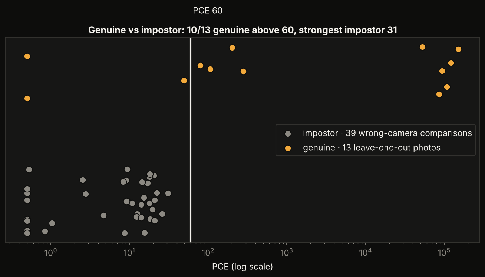</p>

13 leave-one-out *genuine* photos against 39 *impostor* comparisons (wrong camera). **10 of 13** genuine photos pass PCE 60, the strongest impostor reaches only **31**, so no wrong camera is ever accepted. Below 60 (reported, not hidden): the two Samsung A40 photos (no usable fingerprint) and one Nokia 2.2 photo (49).

<details>
<summary>Genuine photos (PCE)</summary>

| photo | camera | PCE (fingerprint from the other photos of that camera) |
|---|---|---|
| 20230504_131116.jpg | Samsung A33 | 85,688.4 |
| 20230505_125151.jpg | Samsung A33 | 107,589.4 |
| 20230527_214315.jpg | Samsung A33 | 53,052.1 |
| 20240509_210037.jpg | Samsung A33 | 94,352.4 |
| 20240518_203321.jpg | Samsung A33 | 150,755.5 |
| 20240520_131048.jpg | Samsung A33 | 121,306.4 |
| A40_00.jpg | Samsung A40 | -0.1 |
| A40_02.jpg | Samsung A40 | -0.0 |
| S7_00.jpg | Samsung S7 | 105.9 |
| S7_03.jpg | Samsung S7 | 278.6 |
| S7_04.jpg | Samsung S7 | 201.2 |
| nokia_01.jpg | Nokia 2.2 | 49.3 |
| nokia_02.jpg | Nokia 2.2 | 79.5 |

</details>

<details>
<summary>Impostor comparisons (PCE)</summary>

| photo | true camera | compared with | PCE |
|---|---|---|---|
| 20230504_131116.jpg | Samsung A33 | Samsung A40 | 31.0 |
| 20230505_125151.jpg | Samsung A33 | Samsung A40 | 20.3 |
| 20230527_214315.jpg | Samsung A33 | Samsung A40 | 17.0 |
| 20240509_210037.jpg | Samsung A33 | Samsung A40 | 18.3 |
| 20240518_203321.jpg | Samsung A33 | Samsung A40 | 25.9 |
| 20240520_131048.jpg | Samsung A33 | Samsung A40 | 17.9 |
| 20230504_131116.jpg | Samsung A33 | Samsung S7 | 8.7 |
| 20230505_125151.jpg | Samsung A33 | Samsung S7 | 9.1 |
| 20230527_214315.jpg | Samsung A33 | Samsung S7 | 8.3 |
| 20240509_210037.jpg | Samsung A33 | Samsung S7 | 17.9 |
| 20240518_203321.jpg | Samsung A33 | Samsung S7 | 12.5 |
| 20240520_131048.jpg | Samsung A33 | Samsung S7 | 4.7 |
| 20230504_131116.jpg | Samsung A33 | Nokia 2.2 | 12.2 |
| 20230505_125151.jpg | Samsung A33 | Nokia 2.2 | 14.1 |
| 20230527_214315.jpg | Samsung A33 | Nokia 2.2 | 9.3 |
| 20240509_210037.jpg | Samsung A33 | Nokia 2.2 | 15.2 |
| 20240518_203321.jpg | Samsung A33 | Nokia 2.2 | 9.3 |
| 20240520_131048.jpg | Samsung A33 | Nokia 2.2 | 14.4 |
| A40_00.jpg | Samsung A40 | Samsung A33 | -1.6 |
| A40_02.jpg | Samsung A40 | Samsung A33 | 0.5 |
| A40_00.jpg | Samsung A40 | Samsung S7 | -0.5 |
| A40_02.jpg | Samsung A40 | Samsung S7 | 1.0 |
| A40_00.jpg | Samsung A40 | Nokia 2.2 | 2.8 |
| A40_02.jpg | Samsung A40 | Nokia 2.2 | -0.6 |
| S7_00.jpg | Samsung S7 | Samsung A33 | 0.8 |
| S7_03.jpg | Samsung S7 | Samsung A33 | 0.0 |
| S7_04.jpg | Samsung S7 | Samsung A33 | 10.8 |
| S7_00.jpg | Samsung S7 | Samsung A40 | 18.2 |
| S7_03.jpg | Samsung S7 | Samsung A40 | 22.3 |
| S7_04.jpg | Samsung S7 | Samsung A40 | 20.8 |
| S7_00.jpg | Samsung S7 | Nokia 2.2 | 9.2 |
| S7_03.jpg | Samsung S7 | Nokia 2.2 | 14.2 |
| S7_04.jpg | Samsung S7 | Nokia 2.2 | 15.6 |
| nokia_01.jpg | Nokia 2.2 | Samsung A33 | -6.8 |
| nokia_02.jpg | Nokia 2.2 | Samsung A33 | -0.8 |
| nokia_01.jpg | Nokia 2.2 | Samsung A40 | 21.0 |
| nokia_02.jpg | Nokia 2.2 | Samsung A40 | 19.5 |
| nokia_01.jpg | Nokia 2.2 | Samsung S7 | -0.2 |
| nokia_02.jpg | Nokia 2.2 | Samsung S7 | 2.5 |

</details>


> All figures are produced by `prnu_detect.py` (Part 1) and `prnu_v2.py` (Part 2); the tables are the Markdown versions of the CSV files in `results/`.

---

## ⚠️ Limits (honest)
- Resized, recompressed or edited copies weaken the fingerprint; heavy edits remove it.
- Some sensors are weak (Samsung A40, Nokia 2.2, one Nikon body) with only 2–6 reference photos.
- Camera 2 in the 39-image demo (girl, cat) uses a **simulated** pattern, because real patterns do not survive resizing. It is labelled `SIM` everywhere.
- The test set is small (39 images, 7 cameras): numbers show behaviour, not benchmark accuracy.
- A missing match never proves an image is AI-generated.

---

## 🚀 Quick start

```bash
git clone https://github.com/Hadifard/PRNU_project_repo.git
cd PRNU_project_repo
pip install -r requirements.txt            # ffmpeg must be on PATH for the videos

# your own images: which of them share a camera?
python prnu_detect.py --folder my_images/ --out result.png
```

Reproduce everything (downloads the data from the release, ~40 min on 2 CPU cores):

```bash
python run_all.py --no-video               # detector, assets, Part 2 (7 cameras)
python run_all.py                          # + both videos (needs the Inter font, see render_video.py)
```

## 🗂️ Repository

| File | Purpose |
|---|---|
| `prnu_detect.py` | Part 1 detector (blur residual, correlation, z-score, camera groups) |
| `prnu_v2.py` | Part 2 modern PRNU (wavelet residual, ML fingerprint, PCE, geometry search, tamper map) |
| `make_demo39.py` | builds the 39-image demo folder and `truth39.json` |
| `orient_nikon.py` | finds the rotation direction of portrait Nikon TIFFs |
| `prep_assets.py`, `prep_extra.py` | numbers and images of Part 1 |
| `prep_v2_orig.py`, `curves.py`, `prep_v2b.py` | Part 2 on 4 phones, scale curves, extension to 7 cameras |
| `render_video.py`, `render_teaser.py` | render the 350 s video and the 118 s teaser (Pillow + ffmpeg) |
| `download_data.py`, `run_all.py` | data download and the full pipeline |
| `results/` | detector output, ground truth, Part 2 numbers (JSON) |
| `docs/` | figures and the teaser GIF used in this README |

## 📚 References
- J. Lukáš, J. Fridrich, M. Goljan. *Digital Camera Identification from Sensor Pattern Noise.* IEEE TIFS, 2006.
- M. Goljan, J. Fridrich, T. Filler. *Large-Scale Test of Sensor Fingerprint Camera Identification.* SPIE, 2009 (PCE).
- M. Chen, J. Fridrich, M. Goljan, J. Lukáš. *Determining Image Origin and Integrity Using Sensor Noise.* IEEE TIFS, 2008.
- M. K. Mihcak, I. Kozintsev, K. Ramchandran. *Spatially adaptive statistical modeling of wavelet image coefficients.* ICASSP, 1999.
- D. Cozzolino, L. Verdoliva. *Noiseprint: a CNN-based camera model fingerprint.* IEEE TIFS, 2020.
- K. Zhang et al. *Beyond a Gaussian Denoiser (DnCNN).* IEEE TIP, 2017.

## 👤 Author
**Hadi Sarhangi Fard** · AI / Machine Learning / Deep Learning
[Portfolio](https://hadifard.github.io/) · [GitHub](https://github.com/Hadifard) · [LinkedIn](https://www.linkedin.com/in/hadi-sarhangi-fard-mech-eng) · [YouTube](https://www.youtube.com/@hfard)
